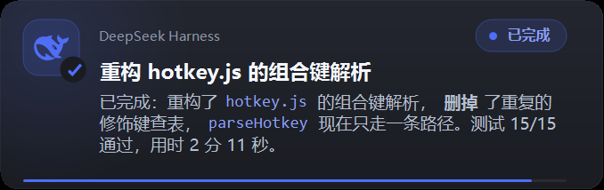
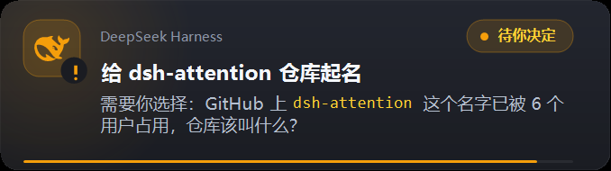
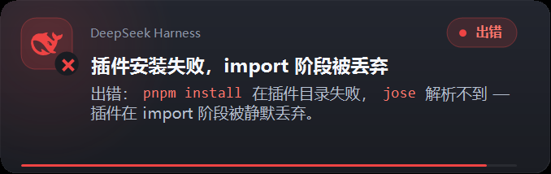

# dsh-attention-notifier

DeepSeek Harness 插件：agent 卡在等你决策时、以及任务结束时，把你叫回来。

不是托盘气泡——是一个**自己画的置顶桌面卡片**，带系统提示音、点击直达会话、以及无人回应时的重复提醒。

> **仅限 Windows。** 卡片由 PowerShell 子进程绘制（`System.Drawing`），声音走 `SoundPlayer`，不支持 macOS / Linux。

## 它解决什么

| 事件 | 卡片 | 说明 |
| --- | --- | --- |
| `user-questions/request` | 橙色 ·「待你决定」 | agent 用 `ask_user_question` 问你，等你选 |
| `approval/request` | 橙色 ·「待你决定」 | 工具请求批准，等你放行 |
| `turn/end` 正常完成 | 蓝色 ·「已完成」 | 任务跑完了 |
| `turn/end` 出错/中断 | 红色 ·「出错」 | 没交付要求的结果 |

**三种色调，各配一种角标字形**（勾 / 感叹号 / 叉）。颜色不是唯一的信号——大约每 12 个男性中有一个分不清这里的蓝和橙——所以每张卡片还带状态词和字形：

| 已完成 | 待你决定 | 出错 |
| :---: | :---: | :---: |
|  |  |  |

正文里的 Markdown 会渲染：`` `代码` `` 变成带底色的等宽芯片，`**加粗**` 变成粗体。截断也是——超过三行的正文以省略号收尾，而不是把卡片撑高。

### 卡片说的是哪个会话

加粗标题是**这个会话的名字**——就是工作区列表里显示的那一行。四个窗口同时开着的时候，
四张卡片都写着「DeepSeek Harness」等于什么都没说，所以标题让位给会话名，只占一行，太长就省略号。
产品名没有丢，它退到标题上方那行小字（配置项 `brand`）。新会话还没生成名字时，
标题退回 `title` 配置的兜底值。

标题的可用宽度是**到状态胶囊左边为止**，所以无论会话名多长，文字都不会压到右边的「已完成」。

一个没人回答的问题是永远不恢复的任务。所以提问类卡片会按 `remindEveryMs` 重复提醒，最多 `maxReminders` 次。

## 安装

### 方式 A：pnpm / npm 安装（推荐）

```bash
# 在 DSH 的 profile 目录里执行（通常是 ~/.dsh/<profile>）
pnpm add @liren2272/dsh-attention
```

然后在该 profile 的 cordis 配置补丁文件里追加：

```yaml
- insert:
    - id: attention-notifier
      name: '@liren2272/dsh-attention'
      config:
        sound: true
        popup: true
        balloon: false
        box: false
        notifyOnQuestion: true
        notifyOnApproval: true
        notifyOnTurnEnd: true
        focusProcess: 'DeepSeek Harness'
        jump: true
```

重启 DeepSeek Harness 生效。仓库里的 `cordis.patch.yml` 就是上面这段（含完整注释），可以直接抄。

### 方式 B：本地目录安装

```bash
git clone https://github.com/liren2272-hue/dsh-attention-notifier.git
# 无需构建，也无需安装依赖：插件是纯 ESM，运行时零第三方依赖
```

在配置补丁里用绝对路径引用该目录。

### 验证是否生效

插件启动后会在日志里写一行 `attention: notifier active`。想确认「到底响没响」，把 `trace` 保持为 `true`，
每次监听进入、每次被抑制、每次投递都会往 `traceFile` 追加一行 JSON。

```
%TEMP%\dsh-attention\trace.log     # 诊断（每次监听进入）
%TEMP%\dsh-attention\notify.log    # 投递（每次尝试响铃）
```

**漏响和「正确地保持安静」从外面看是一模一样的**，所以这个日志是判断依据，不是可选的调试开关。

## 配置

| 键 | 默认值 | 说明 |
| --- | --- | --- |
| `sound` | `true` | 播放系统提示音 |
| `popup` | `true` | 自绘置顶卡片。**这是可靠的那个通道** |
| `balloon` | `false` | 托盘气泡。Focus Assist 下静默显示不出任何东西 |
| `box` | `false` | 模态对话框。会把会话卡住，默认关 |
| `notifyOnQuestion` | `true` | agent 提问时响 |
| `notifyOnApproval` | `true` | 工具请求批准时响 |
| `notifyOnTurnEnd` | `true` | 任务结束时响 |
| `includeSummary` | `true` | 结束卡片带上最后一条回复的摘要 |
| `askGuidance` | `true` | 往系统提示词里注入「何时该问用户」的规则 |
| `minIntervalMs` | `4000` | 同类通知的合并窗口（连问三次只响一次） |
| `remindEveryMs` | `120000` | 无人回应时的重复提醒间隔 |
| `maxReminders` | `3` | 最多重复提醒几次，然后停止 |
| `focusProcess` | `'DeepSeek Harness'` | 点击卡片时唤起哪个进程（按**进程名**匹配，不是窗口标题） |
| `jump` | `true` | 点击卡片时把页面切到打断你的那个会话 |
| `stack` | `true` | 多张卡片同时存在时堆叠（后到的向右上错位） |
| `popupTimeoutMs` | `10000` | 卡片停留时长，0 = 等点击或 Esc。上限 600s |
| `popupMs` | `9000` | 可见时长**下限**，防止手工改太小导致卡片一闪而过 |
| `soundFile` | `C:\Windows\Media\notify.wav` | 提示音文件 |
| `title` | `'DeepSeek Harness'` | 标题**兜底值**。正常情况下加粗标题显示会话名称（取自会话的 `session/title` 事件），只有新会话还没生成名称时才用它 |
| `brand` | `'DeepSeek Harness'` | 标题上方那行小字（产品标识）。与 `title` 拆开，因为标题现在让位给会话名了 |
| `powershell` | `C:\Windows\System32\...\powershell.exe` | 绘制卡片用的 PowerShell |
| `trace` | `true` | 诊断日志。信任它之后可以关掉 |
| `traceFile` | `<临时目录>/dsh-attention/trace.log` | 诊断日志路径 |

配置**没有 cordis schema**——`@deepseek-ai/schemastery` 从 workspace 包里解析不到（已验证 `MODULE_NOT_FOUND`），
所以补丁行是纯 YAML。这意味着拼错的键会被静默接受然后什么都不做，对一个通知插件来说这是最糟的失败。
因此插件**手工校验**：未知键会在日志里点名（能抓到 `popupMS` 这类拼写），数值会被**钳进范围**
（而不是允许弹出一张永不关闭的卡片、或每 tick 就提醒一次）。

## 工作原理

### 为什么不用 Windows toast

宿主进程没有 packaged identity，WinRT `ToastNotificationManager` 直接失败（`HRESULT 0x80073D54`）。
托盘气泡能返回成功但在 Focus Assist 下**什么都不显示**——这是静默失败，不是报错，所以它不再是默认通道。

剩下来唯一总是能画出来的，是一个 **topmost 无边框窗体**：

- 每次响铃 spawn 一个短命的 PowerShell 子进程，用 `System.Drawing` 绘制卡片，然后自己退出
- 标题和正文以 base64 传输，脚本本身保持纯 ASCII（Windows PowerShell 5.1 按 ANSI 读文件）
- 脚本通过**临时文件**传递而不是 `-EncodedCommand`：卡片画大之后超出了 Windows 命令行 32767 字符上限
  （`spawn` 报 `ENAMETOOLONG`，通知直接哑掉）
- 卡片不抢焦点（`SetWindowPos` + `HWND_TOPMOST`，不用 `SetForegroundWindow`），所以在 PowerPoint 里工作不会被打断

### 点击直达会话

唤起窗口只能落到「上次打开的那个会话」，而卡片必须说明**是哪个会话**打断的你。只有浏览器页面能切自己的视图，
所以这条链是三段式的：

1. 响铃时生成一个绑定 sessionId 的一次性 UUID token，注册到 `/dsh-attention/click/<token>`
2. 卡片被点击时 POST 这个 token 给宿主路由
3. 插件的浏览器半边（`client.js`）轮询 `/dsh-attention/pending`，拿到 sessionId 后调用 `uiWorkspace.openSession`

token 本身就是 capability——发起请求的是一个没有浏览器身份的分离 PowerShell，而响应不带数据（204），
所以伪造请求只能消耗掉伪造者已经在屏幕上看见过的 token。

### 为什么挂 `prepend`

cordis 的 waterfall 监听是**最外层优先**（`cbs.shift()`），一个不调用 `next()` 就应答的监听会屏蔽掉它里面的所有监听。
本插件注册在最后（bundle 在 profile 列表末尾），所以任何内建应答者都会把它完全挡住。
因此用 `{ prepend: true }` 插到最前面，并且每次进入监听都记一条 trace——「宿主没调用我」和「我们被调用了但选择保持安静」
必须能区分开。

## 测试

```bash
npm test              # 295 个集成场景（走真实 apply() 与桩 context）
npm run test:markdown # Markdown 子集单测
```

宿主是 Electron under `ELECTRON_RUN_AS_NODE`，如果 PATH 里没有 Node（>= 22.19）：

```powershell
$env:ELECTRON_RUN_AS_NODE = '1'
& 'C:\Program Files\Deepseek\DeepSeek Harness.exe' test/run.mjs
```

`test/run.mjs` 不 spawn 真实 PowerShell——它把生成的脚本从磁盘读回来断言内容，
所以整套测试在 CI 和无图形界面的机器上都能跑。

### 重新渲染 README 的效果图

`test/render-screenshots.mjs` 用插件自己的 `buildScript` 生成三张卡片（每种色调一张），
等卡片窗口出现后用 `PrintWindow` 把**卡片本身**（不含桌面背景）截成 PNG：

```bash
node test/render-screenshots.mjs    # 输出到 docs/screenshots/
```

截图只包含卡片窗口，因此可以安全地放进公开仓库。

## 目录结构

```
index.js            插件入口：配置校验、三个监听缝、点击跳转路由、堆叠计数
notify.js           投递层：PowerShell/Win32 卡片程序、提示音、日志
markdown.js         卡片用的极简 Markdown 渲染器（行 → span → 样式位）
client.js           浏览器半边：轮询 pending 队列，调用 openSession
cordis.patch.yml    cordis 配置补丁
icon.svg            插件图标
locale/             插件在 DSH 设置界面显示的名称与描述（en / zh）
docs/screenshots/   README 里的卡片效果图（由 test/render-screenshots.mjs 渲染）
test/               run.mjs（295 场景）· markdown.mjs · harness.mjs · render-screenshots.mjs
```

## License

[MIT](./LICENSE)
